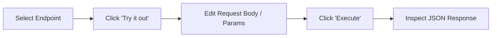
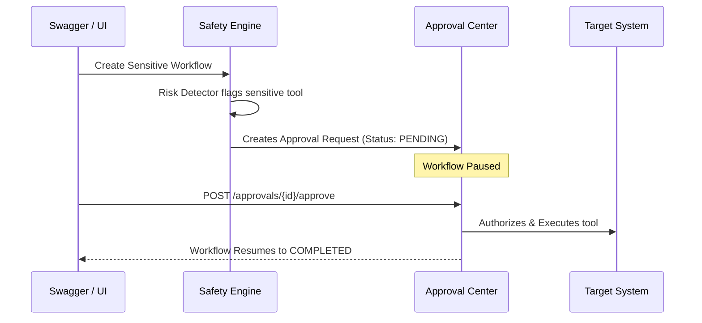

# LoopGuard: Complete Swagger UI API Execution Guide

> **Base Swagger URL:** [http://127.0.0.1:8000/docs](http://127.0.0.1:8000/docs)  
> **Alternative ReDoc URL:** [http://127.0.0.1:8000/redoc](http://127.0.0.1:8000/redoc)

This document provides a comprehensive, step-by-step operational guide to executing every single endpoint in the FastAPI Swagger UI documentation.

---

## 1. Quick Swagger Navigation Basics

1. Open your browser and navigate to **`http://127.0.0.1:8000/docs`**.
2. Click on any endpoint row (e.g., `POST /api/v1/workflows`) to expand its parameters and schemas.
3. Click the white **"Try it out"** button located on the right side of the expanded panel.
4. Fill in or edit the JSON payload / URL parameters.
5. Click the large blue **"Execute"** button.
6. Scroll down to view the **Server response** (`Code`, `Response body`, and `Response headers`).



---

## 2. Health & Monitoring Module

### 2.1 `GET /health` — Service Health Check
* **Category:** Health
* **Purpose:** Verifies that the FastAPI server, database connection (SQLite/PostgreSQL), and Redis/In-memory fallback cache are online.
* **How to run:**
  1. Expand **`GET /health`**.
  2. Click **"Try it out"**.
  3. Click **"Execute"**.
* **Expected Response (`200 OK`):**
  ```json
  {
    "status": "healthy",
    "service": "Agent Workflow Safety & Loop Prevention Engine",
    "database_connected": true,
    "redis_connected": false,
    "redis_fallback_mode": true
  }
  ```

### 2.2 `GET /metrics` — Prometheus Metrics
* **Category:** Metrics
* **Purpose:** Exports raw Prometheus metrics for monitoring active workflows, steps executed, loop counters, and safety events.
* **How to run:**
  1. Expand **`GET /metrics`**.
  2. Click **"Try it out"** $\to$ **"Execute"**.
* **Expected Response (`200 OK`):** Text formatted metrics (e.g., `safety_workflows_total{...} 5.0`).

---

## 3. Workflows Module (`/api/v1/workflows`)

### 3.1 `POST /api/v1/workflows` — Create & Trigger Workflow
* **Purpose:** Creates a new AI agent workflow and immediately dispatches it as an asynchronous background worker (`auto_run=true`).
* **Query Parameters:**
  * `auto_run`: `true` (default: automatically executes in background).

#### Payload Examples for Different Scenarios:

#### Scenario A: Normal Progress Workflow (Success)
```json
{
  "task": "Audit engineering personnel and compile quarterly readiness report",
  "agent_type": "mock:normal_success"
}
```
* **Expected Result:** Proceeds through 3 tool steps (`search_employees` $\to$ `get_employee_details` $\to$ `generate_report`) and reaches `COMPLETED` status.

#### Scenario B: Infinite Cyclic Loop (Safety Engine Block)
```json
{
  "task": "Test cyclic infinite loop detection",
  "agent_type": "mock:infinite_loop"
}
```
* **Expected Result:** Alternates `tool_a` and `tool_b`. After 2 full cycles, Gate 4 blocks execution with `status: "BLOCKED"` and `rule_triggered: "INFINITE_LOOP_PREVENTION"`.

#### Scenario C: Repeated Identical Calls (Budget Guard Block)
```json
{
  "task": "Repeatedly query stagnant directory",
  "agent_type": "mock:repeated_calls"
}
```
* **Expected Result:** Calls identical tool arguments 3 times $\to$ blocked by Gate 3 (`REPEATED_TOOL_CALL_DETECTED`).

#### Scenario D: Sensitive Tool Execution (Human-in-the-Loop)
```json
{
  "task": "Adjust executive compensation in HR database",
  "agent_type": "mock:sensitive_action"
}
```
* **Expected Result:** Halts at `modify_employee_salary` with `status: "PAUSED_APPROVAL"`, awaiting human review in the Approvals Center.

#### Scenario E: Real Google Gemini LLM (Optional)
```json
{
  "task": "Summarize latest company safety report",
  "agent_type": "gemini"
}
```
*(Requires `GEMINI_API_KEY` in `.env`)*

---

### 3.2 `GET /api/v1/workflows` — List All Workflows
* **Purpose:** Fetches all executed workflows with pagination and filtering.
* **Parameters:**
  * `skip`: `0`
  * `limit`: `20`
  * `status_filter` *(Optional)*: `COMPLETED`, `BLOCKED`, `PAUSED_APPROVAL`, or leave empty for all.
* **How to run:**
  1. Click **"Try it out"**.
  2. (Optional) Set `status_filter` to `BLOCKED`.
  3. Click **"Execute"**.

---

### 3.3 `GET /api/v1/workflows/{workflow_id}` — Inspect Workflow Execution Details
* **Purpose:** Returns the complete lifecycle details of a specific workflow, including every individual step, raw arguments, sanitized arguments, SHA-256 hashes, execution duration, and safety decisions (`ALLOW` / `BLOCK`).
* **Parameters:**
  * `workflow_id`: Paste the UUID received from `POST /api/v1/workflows` (e.g. `0be878f0-5fa4-4530-9d9b-7ae1ee2e091d`).
* **How to run:**
  1. Enter your `workflow_id`.
  2. Click **"Execute"**.
* **Key Fields in Output:**
  * `status`: `COMPLETED` / `BLOCKED` / `PAUSED_APPROVAL`
  * `termination_reason`: Explanation of why safety gate stopped it.
  * `steps`: Array of executed steps with normalized hashes.

---

### 3.4 `GET /api/v1/workflows/{workflow_id}/events` — Workflow Safety Alerts
* **Purpose:** Returns all safety violations and audit events generated exclusively by this workflow.
* **Parameters:**
  * `workflow_id`: Workflow UUID.
* **How to run:** Paste `workflow_id` $\to$ Click **"Execute"**.

---

### 3.5 `POST /api/v1/workflows/{workflow_id}/stop` — Manual Kill Switch
* **Purpose:** Allows a user or administrator to forcefully terminate a running workflow.
* **Parameters:**
  * `workflow_id`: Workflow UUID.
* **How to run:** Paste `workflow_id` $\to$ Click **"Execute"**.
* **Output:** Workflow status switches to `STOPPED`.

---

### 3.6 `POST /api/v1/workflows/{workflow_id}/resume` — Resume Paused Workflow
* **Purpose:** Manually resume a paused workflow from its last saved state.
* **Parameters:**
  * `workflow_id`: Workflow UUID.
* **How to run:** Paste `workflow_id` $\to$ Click **"Execute"**.

---

### 3.7 `POST /api/v1/workflows/{workflow_id}/retry` — Reset and Retry Workflow
* **Purpose:** Clears historical step records and restarts execution from Step 1.
* **Parameters:**
  * `workflow_id`: Workflow UUID.
* **How to run:** Paste `workflow_id` $\to$ Click **"Execute"**.

---

## 4. Human-in-the-Loop Approvals Module (`/api/v1/approvals`)



### 4.1 `GET /api/v1/approvals` — List Pending Approvals
* **Purpose:** Lists all requests waiting for human approval or previously reviewed.
* **Parameters:**
  * `status_filter` *(Optional)*: `PENDING`, `APPROVED`, or `REJECTED`.
* **How to run:** Click **"Try it out"** $\to$ Click **"Execute"**.
* **Output:** Look for the `"id"` field of the pending approval (e.g., `appr-1234...`).

---

### 4.2 `POST /api/v1/approvals/{approval_id}/approve` — Approve Sensitive Action
* **Purpose:** Authorizes the sensitive tool execution. The backend logs the reviewer audit trail and automatically resumes the workflow to completion.
* **Parameters & Headers:**
  * `approval_id`: The ID of the pending approval request.
  * `x-user-role`: `admin` (or `reviewer`, `lead_engineer`).
* **Request Body:**
  ```json
  {
    "reviewed_by": "Sarah Jenkins (Security Lead)",
    "comment": "Salary adjustment verified against signed HR contract #HR-908."
  }
  ```
* **How to run:**
  1. Click **"Try it out"**.
  2. Paste `approval_id`.
  3. Ensure `x-user-role` is set to `admin`.
  4. Paste the JSON request body.
  5. Click **"Execute"**.
* **Result:** Status changes to `APPROVED`. The workflow resumes immediately in the background and finishes execution.

---

### 4.3 `POST /api/v1/approvals/{approval_id}/reject` — Reject Sensitive Action
* **Purpose:** Denies the sensitive action. The workflow is permanently halted for safety.
* **Parameters & Headers:**
  * `approval_id`: The ID of the pending approval.
  * `x-user-role`: `admin`.
* **Request Body:**
  ```json
  {
    "reviewed_by": "Sarah Jenkins (Security Lead)",
    "comment": "Rejected due to missing authorization memo."
  }
  ```
* **Result:** Status changes to `REJECTED`. Workflow marks as blocked.

---

## 5. Safety & Policy Configuration Module (`/api/v1/safety`)

### 5.1 `GET /api/v1/safety/events` — Global Safety Audit Trail
* **Purpose:** Fetches all safety interceptions and security alerts across all workflows.
* **Parameters:**
  * `severity` *(Optional)*: `CRITICAL`, `HIGH`, `WARNING`, `INFO`.
  * `rule_name` *(Optional)*: Filter by detector (e.g., `INFINITE_LOOP_PREVENTION`).
  * `limit`: `100`
* **How to run:** Click **"Try it out"** $\to$ Click **"Execute"**.

---

### 5.2 `GET /api/v1/safety/rules` — List Registered Safety Rules
* **Purpose:** Returns the catalogue of all 5 safety detectors, descriptions, and default thresholds.
* **How to run:** Click **"Try it out"** $\to$ Click **"Execute"**.

---

### 5.3 `GET /api/v1/safety/config` — View Active Safety Policy
* **Purpose:** Retrieves the current active safety thresholds, timeout durations, and sensitive tool allowlists.
* **How to run:** Click **"Try it out"** $\to$ Click **"Execute"**.

---

### 5.4 `PUT /api/v1/safety/config` — Update Safety Policy Live
* **Purpose:** Dynamically modifies safety thresholds and adds new sensitive tools without restarting the server.
* **Request Body Example:**
  ```json
  {
    "name": "Updated Production Policy",
    "is_active": true,
    "max_workflow_steps": 15,
    "max_repeated_calls": 3,
    "max_execution_duration_seconds": 180.0,
    "max_tool_calls": 40,
    "max_retries": 2,
    "loop_cycle_threshold": 2,
    "max_no_progress_steps": 3,
    "auto_block_no_progress": true,
    "sensitive_tools": [
      "modify_employee_salary",
      "delete_employee_record",
      "execute_payment",
      "drop_database_table",
      "send_external_email",
      "grant_admin_access",
      "reboot_server_node"
    ],
    "sensitive_argument_patterns": [
      "password", "secret", "token", "api_key", "credit_card", "ssn"
    ]
  }
  ```
* **How to run:** Paste the updated JSON $\to$ Click **"Execute"**.

---

## 6. Analytics Module (`/api/v1/analytics`)

### 6.1 `GET /api/v1/analytics` — Dashboard Analytics & Metrics
* **Purpose:** Aggregates real-time statistics from the database, including total workflows, success/blocked counts, loop prevention counts, average execution durations, and tool frequency distribution.
* **How to run:** Click **"Try it out"** $\to$ Click **"Execute"**.
* **Expected Response:**
  ```json
  {
    "total_workflows": 6,
    "successful_workflows": 3,
    "blocked_workflows": 2,
    "failed_workflows": 0,
    "running_workflows": 0,
    "approval_pending_count": 1,
    "loop_detected_workflows": 2,
    "avg_duration_seconds": 0.28,
    "tool_distribution": {
      "tool_a": 6,
      "tool_b": 6,
      "search_employees": 3,
      "get_employee_details": 3,
      "generate_report": 3
    }
  }
  ```

---

## 7. Recommended End-to-End Testing Sequence

To test the entire platform end-to-end in Swagger, execute endpoints in this order:

1. **Check Health:** Call `GET /health` to ensure all services are ready.
2. **Trigger Normal Flow:** Call `POST /api/v1/workflows` with `mock:normal_success`.
3. **Trigger Loop Prevention:** Call `POST /api/v1/workflows` with `mock:infinite_loop`.
4. **Inspect Trace:** Copy the loop workflow ID and call `GET /api/v1/workflows/{id}` to verify `status: "BLOCKED"`.
5. **Inspect Violations:** Call `GET /api/v1/safety/events` to verify `INFINITE_LOOP_PREVENTION`.
6. **Trigger Approval:** Call `POST /api/v1/workflows` with `mock:sensitive_action`.
7. **Find Approval ID:** Call `GET /api/v1/approvals?status_filter=PENDING`.
8. **Approve Action:** Call `POST /api/v1/approvals/{id}/approve` and watch the workflow resume and complete!
9. **View Analytics:** Call `GET /api/v1/analytics` to view the updated execution metrics.

